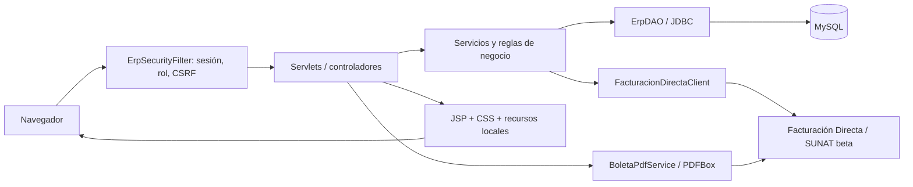

# Arquitectura y permisos

## Capas

- `controller`: lectura de parámetros, respuesta HTTP, navegación y mensajes.
- `service`: autorización funcional, validación, agenda, pacientes, recursos y caja.
- `dao/ErpDAO`: conexiones y unidades de trabajo JDBC con commit/rollback.
- `security` y `filter`: PBKDF2, sesiones, CSRF y restricciones por rol.
- `sunat`: construcción del comprobante, transporte HTTP y clasificación de respuestas.
- `pdf`: personalización de la imagen de cabecera, conservando el comprobante.
- `WEB-INF/views`: vistas JSP accesibles mediante controladores.

## Permisos principales

| Acción | Paciente | Secretaría | Odontólogo | Administrador |
|---|---|---|---|---|
| Navegación de Pacientes | Oculta | Sí | Sí | Sí |
| Datos/historial | Propios según servicio | Gestión autorizada | Según autorización | Gestión |
| Citas | Propias | Gestión | Agenda/atención autorizada | Gestión |
| Recursos | No | No | No | Sí |
| Cobrar, Caja y PDF de boletas | No | Sí | No | Sí |

La visibilidad del menú acompaña a la autorización en filtros y servicios.
Cada POST verifica CSRF; los mensajes del proveedor se muestran escapados.

## Consistencia de citas y cobros

Las reservas validan la relación servicio–odontólogo, duración, jornada y cruces.
Restricciones SQL y bloqueo transaccional refuerzan la validación de servicios.
Cada cita genera un pago pendiente. El cobro actualiza pago/cita y reserva el
correlativo dentro de la misma transacción. El envío externo sucede después del
commit, sin bloquear una conexión MySQL durante la espera HTTP.

`emisiones_cpe.id_pago` y la combinación RUC/tipo/serie/número son únicos. Solo
`data.error=false` y código SUNAT `0` producen `ACEPTADO_DEMO`.

## Persistencia

Tablas centrales: `usuarios`, `roles`, `servicios`, `horarios_odontologos`,
`odontologo_servicios`, `citas`, `pagos`, `comprobantes`, `consultas_sunat`,
`series_cpe_demo`, `emisiones_cpe` y `erp_migraciones`.
Las migraciones se encuentran en `database/`; no se incluye un dump de los datos
de trabajo en el repositorio público.

## Decisiones de alcance

Se conserva Java/Servlets/JSP y MVC–DAO para facilitar la explicación académica.
Los cuatro módulos comparten una aplicación WAR. No se incorporan microservicios
ni se cambia el framework. El frontend se sirve con recursos locales, sin un
servidor Node en ejecución.
